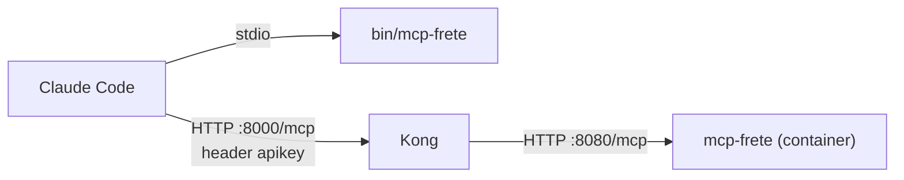
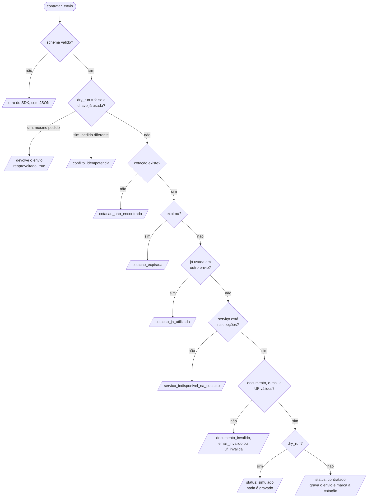

# Laboratório MCP de frete: Claude Code e Kong

Servidor MCP em Go com duas tools que simulam um fluxo de produção, e uma skill que as orquestra. O objetivo é observar como o Claude Code decide, pergunta e reage a erros, e como o Kong se comporta na frente de um servidor MCP.

| Peça | Arquivo |
|---|---|
| Tools `cotar_frete` e `contratar_envio` | `frete.go` |
| Skill que orienta o uso das tools | `.claude/skills/frete-envio/SKILL.md` |
| Servidor, transportes stdio e HTTP | `main.go` |
| Gateway Kong e Docker | `deploy/`, `Dockerfile` |
| Testes | `frete_test.go`, `server_test.go` |

O servidor roda de dois jeitos:

| Modo | Transporte | Entrada no `.mcp.json` | Para que serve |
|---|---|---|---|
| Local | stdio | `mcp-frete` | Desenvolvimento e teste rápido no Claude Code |
| Via gateway | Streamable HTTP em `/mcp` | `mcp-frete-kong` (em `.mcp.kong.example.json`) | Testar autenticação e rate limit do Kong |

Comece pelo stdio (não exige Docker). Passe para o Kong quando quiser validar autenticação, rate limit ou falhas de rede. Para depurar só o transporte HTTP, sem gateway, use o passo 7. Usar os dois modos ao mesmo tempo duplica as tools no Claude Code; desative um deles em `/mcp`.



## 1. Pré-requisitos

- Go (a versão mínima está no `go.mod`)
- Docker e Docker Compose (só para o Kong)
- Claude Code
- `curl` (opcional)

## 2. Testes automatizados

```bash
go test ./...
```

Cobrem as regras de preço e restrição, o fluxo completo cotar → simular → contratar, idempotência, expiração (com relógio falso), validação de schema e o transporte HTTP.

## 3. Compilar

```bash
go build -o bin/mcp-frete .
```

O `.mcp.json` aponta para `./bin/mcp-frete`. Recompile sempre que mudar o código e reinicie o Claude Code (ou reconecte pelo `/mcp`).

## 4. As tools

| Tool | O que faz | Complexidade |
|---|---|---|
| `cotar_frete` | Cota economico, padrao e expresso e devolve um `cotacao_id` válido por 15 min | Parâmetros aninhados (lista de itens com dimensões), enums, padrões, resultado parcial (`descartadas`, `avisos`) |
| `contratar_envio` | Contrata uma cotação | Efeito colateral: `dry_run` por padrão, `chave_idempotencia`, estado entre chamadas, expiração |

O estado (cotações e envios) fica em memória e some quando o servidor reinicia.

### Decisão do `contratar_envio`

A ordem das checagens em `handlers.go` importa: a idempotência vem antes de tudo, e o `dry_run` só corta no final, depois de validar o pedido inteiro.



### Regras de negócio

- **Zona** pelo primeiro dígito dos CEPs: igual é local, até 3 de diferença é regional, o resto é nacional. A zona muda preço (×1, ×1,25, ×1,6) e prazo.
- **Peso taxado:** o maior entre o peso real e o cubado (C×L×A÷6000), somando todas as unidades.
- **Categorias:** perecível só vai de expresso e só dentro da região; bateria não vai no econômico; líquido e frágil cobram taxa; inflamável é proibido.
- **Limites:** 150 cm por dimensão, 70 kg por pacote, R$ 10.000 declarados. Acima de 30 kg o econômico sai. Acima de R$ 1.000 sem seguro vem um aviso.
- **Seguro:** 1,2% do valor declarado, mínimo R$ 5.
- **Prazo máximo** que nenhum serviço atende não é erro: volta `opcoes` vazio com os motivos em `descartadas`.

### Códigos de erro

O corpo vem em JSON: `{"erro": código, "mensagem": ..., "sugestao": ...}`, com `isError: true`.

`cep_invalido`, `item_proibido`, `dimensao_excede_limite`, `peso_excede_limite`, `valor_declarado_excede_limite`, `perecivel_fora_da_regiao`, `cotacao_nao_encontrada`, `cotacao_expirada`, `cotacao_ja_utilizada`, `servico_indisponivel_na_cotacao`, `documento_invalido`, `email_invalido`, `uf_invalida`, `conflito_idempotencia`.

Violações do schema (CEP fora do padrão, enum errado, lista vazia) são barradas pelo SDK antes do handler e também voltam como `isError`, mas sem esse corpo JSON.

## 5. Testar no Claude Code (stdio)

1. Abra o Claude Code **na raiz do projeto**:
   ```bash
   cd lab-mcp-tools-go
   claude
   ```
2. Aprove os servidores do projeto quando pedir.
3. Rode `/mcp` (ou `claude mcp list` no terminal) e confirme `mcp-frete` como **connected**.
4. Peça um cenário da tabela abaixo.

As tools aparecem como `mcp__mcp-frete__cotar_frete` e `mcp__mcp-frete__contratar_envio` (e `mcp__mcp-frete-kong__...` via Kong).

### Cenários para exercitar

Peça em linguagem natural e observe quais argumentos o Claude escolhe, o que ele pergunta e quando ele para.

| Pedido | O que observar |
|---|---|
| "Quanto custa mandar 2 camisetas de 300 g (caixa 30×20×5) de 01310-100 para 80010-000?" | Converte 300 g em `0.3`, apresenta as 3 opções em tabela (resultado esperado: R$ 25,28 / 39,36 / 67,52) |
| "Cota o frete de um notebook" | Deve perguntar CEPs, peso e dimensões; não inventa. Deve inferir `categoria: bateria` |
| "Preciso entregar em 2 dias, de São Paulo para Curitiba" | Usa `prazo_maximo_dias: 2`; se vier `opcoes` vazio, propõe relaxar sem aplicar sozinho |
| "Manda 3 litros de álcool 70%" | Erro `item_proibido`; deve explicar e não insistir |
| "Envia 5 kg de morango de 01310-100 para 80010-000" | Erro `perecivel_fora_da_regiao`; não deve trocar de serviço |
| "Cota um pacote de R$ 3.000 em eletrônicos" | Avisa sobre seguro e pergunta se quer incluir |
| "Pode contratar o expresso" (logo após cotar, sem dados do destinatário) | Deve pedir nome, documento e endereço; não inventa |
| Contratação completa | Faz `dry_run` primeiro, mostra o resumo, pede confirmação e só então manda `dry_run: false` com a mesma chave |
| "Contrata de novo" (mesmo envio) | Reusa a chave e recebe `reaproveitado: true`, sem duplicar |
| Esperar mais de 15 min entre cotar e contratar | Erro `cotacao_expirada`; deve recotar e reconfirmar o preço |

### Experimento: com e sem a skill

Rode os mesmos pedidos com a skill `frete-envio` e depois sem ela (renomeando a pasta temporariamente). Compare quantas vezes o Claude contrata sem confirmar, inventa dados pessoais ou reaproveita chave de idempotência indevidamente.

## 6. Inspecionar sem o Claude Code (opcional)

```bash
npx @modelcontextprotocol/inspector ./bin/mcp-frete
```

Confira o `inputSchema` de `cotar_frete` (itens com `minItems` 1 e `maxItems` 20, enums, padrões de CEP) e as annotations: `contratar_envio` é destrutiva e idempotente, `cotar_frete` não é destrutiva.

## 7. Testar o modo HTTP sem o Kong

```bash
./bin/mcp-frete -http :8080
```

Os logs saem no stderr com o prefixo `[mcp-frete]`. O stdout é reservado ao protocolo no modo stdio.

Em outro terminal, faça o handshake. O header `Accept` com os dois tipos é obrigatório no Streamable HTTP:

```bash
curl -i http://localhost:8080/mcp \
  -H 'Content-Type: application/json' \
  -H 'Accept: application/json, text/event-stream' \
  -d '{"jsonrpc":"2.0","id":1,"method":"initialize","params":{"protocolVersion":"2025-03-26","capabilities":{},"clientInfo":{"name":"curl","version":"0"}}}'
```

Guarde o `Mcp-Session-Id` da resposta. Depois:

```bash
SID=<valor-do-header>

curl -s http://localhost:8080/mcp \
  -H 'Content-Type: application/json' -H 'Accept: application/json, text/event-stream' \
  -H "Mcp-Session-Id: $SID" \
  -d '{"jsonrpc":"2.0","method":"notifications/initialized"}'

curl -s http://localhost:8080/mcp \
  -H 'Content-Type: application/json' -H 'Accept: application/json, text/event-stream' \
  -H "Mcp-Session-Id: $SID" \
  -d '{"jsonrpc":"2.0","id":2,"method":"tools/call","params":{"name":"cotar_frete","arguments":{"origem_cep":"01310-100","destino_cep":"80010-000","itens":[{"sku":"camiseta","quantidade":2,"peso_kg":0.3,"valor_unitario":50,"dimensoes":{"comprimento":30,"largura":20,"altura":5}}]}}}'
```

## 8. Subir o Kong

A configuração fica em `deploy/` (modo DB-less, declarativo):

- `deploy/docker-compose.yml` sobe `mcp-frete` (build pelo `Dockerfile`) e `kong:3.9`.
- `deploy/kong.yml` define o serviço, a rota `/mcp`, o plugin `key-auth` (header `apikey`) e o `rate-limiting` (10 requisições por minuto, política `local`).
- O consumer `poc` tem a chave `poc-chave-local`.

```bash
docker compose -f deploy/docker-compose.yml up --build
```

Depois de mudar o código, rode com `--build` de novo para reconstruir a imagem.

| Porta | O que é |
|---|---|
| 8000 | Proxy (é o que o cliente MCP usa) |
| 8001 | Admin API |
| 8002 | Admin GUI |

Confirme que o Kong carregou a configuração:

```bash
curl -s localhost:8001/services | head
curl -s localhost:8001/routes   | head
curl -s localhost:8001/plugins  | head
```

## 9. Autenticação e rate limit no Kong

**Sem chave** (esperado: `401`):

```bash
curl -i http://localhost:8000/mcp \
  -H 'Content-Type: application/json' -H 'Accept: application/json, text/event-stream' \
  -d '{"jsonrpc":"2.0","id":1,"method":"initialize","params":{"protocolVersion":"2025-03-26","capabilities":{},"clientInfo":{"name":"curl","version":"0"}}}'
```

**Com chave** (esperado: `200` e um `Mcp-Session-Id`): repita acrescentando `-H 'apikey: poc-chave-local'`.

**Rate limit** (esperado: `429` a partir da 11ª chamada no mesmo minuto):

```bash
for i in $(seq 1 12); do
  curl -s -o /dev/null -w "%{http_code}\n" http://localhost:8000/mcp \
    -H 'apikey: poc-chave-local' \
    -H 'Content-Type: application/json' -H 'Accept: application/json, text/event-stream' \
    -d '{"jsonrpc":"2.0","id":1,"method":"initialize","params":{"protocolVersion":"2025-03-26","capabilities":{},"clientInfo":{"name":"curl","version":"0"}}}'
done
```

Cada chamada MCP (initialize, notificação, tools/list, tools/call) conta no limite. O fluxo de frete gasta várias chamadas, então o `429` aparece rápido. Espere 1 minuto ou aumente `minute` em `deploy/kong.yml`.

## 10. Kong pelo Claude Code

O `.mcp.json` traz só o modo stdio. Para o Kong, copie a entrada de `.mcp.kong.example.json` para o seu `.mcp.json` (ou rode `claude mcp add --transport http mcp-frete-kong http://localhost:8000/mcp --header "apikey: poc-chave-local"`):

```json
"mcp-frete-kong": {
  "type": "http",
  "url": "http://localhost:8000/mcp",
  "headers": { "apikey": "poc-chave-local" }
}
```

1. Deixe o Kong rodando (passo 8).
2. Abra o Claude Code na raiz do projeto, ou reconecte pelo `/mcp`.
3. Confirme que `mcp-frete-kong` está **connected**.
4. Rode os cenários do passo 5.
5. Nos logs do `docker compose`, o Kong mostra cada `POST /mcp` e o `mcp-frete` mostra as linhas `cotar_frete: ...` e `contratar_envio: ...`.

### Provocando falhas de propósito

| Experimento | Como fazer | O que observar |
|---|---|---|
| Chave errada | Troque `apikey` no `.mcp.json` e reinicie o Claude Code | `mcp-frete-kong` fica **failed** (401) |
| Rate limit | Faça mais de 10 chamadas em 1 minuto | Tool falha com 429; volta após 1 minuto |
| Upstream fora | `docker compose -f deploy/docker-compose.yml stop mcp-frete` | Kong responde 502/503 |
| Kong fora | `docker compose -f deploy/docker-compose.yml stop kong` | Conexão recusada em `:8000` |
| Restart do servidor | `docker compose -f deploy/docker-compose.yml restart mcp-frete` | Cotações e envios somem: `cotacao_nao_encontrada` ao contratar |

## 11. Encerrar

```bash
docker compose -f deploy/docker-compose.yml down
```

## 12. Problemas comuns

| Sintoma | Causa provável | Solução |
|---|---|---|
| `mcp-frete` não aparece ou está failed | Binário ausente ou Claude Code aberto fora da raiz | `make build`, e abra o `claude` na raiz |
| Mudei o código e nada mudou | Binário ou imagem antigos | Recompile (ou `up --build`) e reconecte pelo `/mcp` |
| `curl` retorna 400 ou 406 | Faltou `Accept: application/json, text/event-stream` | Adicione o header |
| `tools/call` falha após o `initialize` | Faltou `Mcp-Session-Id` ou a notificação `initialized` | Siga o passo 7 na ordem |
| `401 No API key found` | Header `apikey` ausente | Adicione `-H 'apikey: poc-chave-local'` |
| `429 API rate limit exceeded` | Passou de 10 requisições por minuto | Espere ou aumente o limite no `kong.yml` |
| Kong não sobe | Erro de sintaxe no `kong.yml` | `docker compose ... logs kong` |
| Resposta do Kong trava ou chega em bloco | Buffering do proxy | O `kong.yml` já desliga `request_buffering` e `response_buffering` na rota; mantenha assim |

## 13. Limitações conhecidas

- Estado só em memória: cotações e envios somem ao reiniciar, e cotações expiradas não são removidas (laboratório; em produção use um banco com TTL).
- O servidor não autentica: a autenticação é responsabilidade do gateway. Não exponha a porta 8080 diretamente.
- A chave `poc-chave-local` e as regras de preço são de demonstração.
