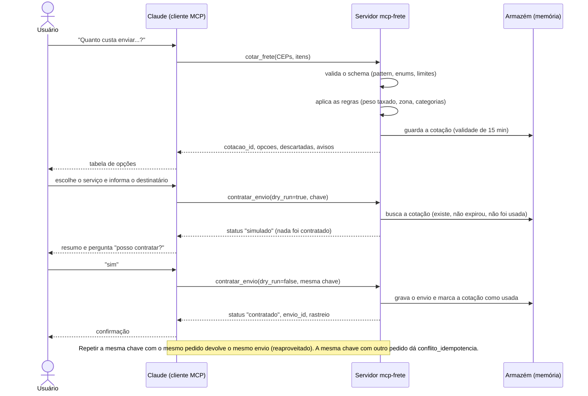
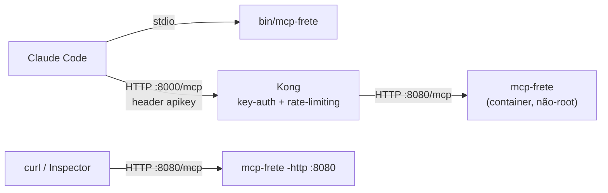

# mcp-frete — template de servidor MCP em Go

Servidor [MCP](https://modelcontextprotocol.io) em Go com duas tools que simulam um fluxo de produção (cotar e contratar frete), uma skill do Claude Code que as orquestra e um gateway Kong na frente. Serve como **base para o seu próprio servidor MCP**.

## O que ele demonstra

- **Tools bem descritas:** schemas JSON com limites, enums e exemplos; `outputSchema`; annotations (`destructiveHint`, `idempotentHint`, `openWorldHint`).
- **Erros acionáveis:** erros de negócio voltam como `isError: true` com `{erro, mensagem, sugestao}`, para o agente se corrigir sozinho.
- **Ações irreversíveis seguras:** `dry_run` por padrão e chave de idempotência.
- **Dois transportes:** stdio (local) e Streamable HTTP (`/mcp`, `/healthz`), com shutdown gracioso.
- **Skill** (`.claude/skills/frete-envio`) que ensina o agente quando perguntar, assumir e confirmar.
- **Gateway** Kong DB-less com `key-auth` e `rate-limiting` (`deploy/`).
- **Testes** com cliente MCP real em transporte em memória e via HTTP, CI e Docker não-root.

## Início rápido

```bash
make build        # gera bin/mcp-frete
make test         # go test -race -cover
claude            # na raiz; o .mcp.json já registra o servidor (stdio)
```

Peça, por exemplo: *"Quanto custa mandar 2 camisetas de 300 g (caixa 30×20×5) de 01310-100 para 80010-000?"*

O passo a passo completo (cenários de teste, Inspector, curl, Kong, falhas provocadas) está em [GUIA.md](GUIA.md).

## Como funciona

### Fluxo de uma contratação

Cada validação acontece em um ponto diferente: o schema barra o formato antes do handler, o handler aplica as regras de negócio, e o usuário confirma antes de qualquer efeito irreversível.



### Modos de execução



## Qual modo usar?

| Modo | Quando usar | Como |
|---|---|---|
| **stdio** (padrão) | Desenvolver tools e regras; iterar rápido no Claude Code. Não precisa de Docker. | `make build` e abrir o `claude` na raiz (`.mcp.json` já registra `mcp-frete`) |
| **HTTP direto** | Depurar o transporte com `curl` ou o MCP Inspector, sem gateway. | `make run-http` (escuta em `:8080/mcp`) |
| **HTTP via Kong** | Validar o servidor atrás de um gateway: autenticação (`apikey`), rate limit e falhas de rede. | `make docker`, e copiar a entrada de `.mcp.kong.example.json` para o seu `.mcp.json` |

O `.mcp.json` traz só o modo stdio de propósito: assim o projeto funciona logo após o clone, sem Docker. O Kong é opcional. Se você usar os dois modos ao mesmo tempo, as tools aparecem duplicadas (`mcp__mcp-frete__*` e `mcp__mcp-frete-kong__*`); desative um deles em `/mcp`.

## Usando como template

1. Clique em **Use this template** no GitHub (ou faça fork).
2. Troque o module path em `go.mod` e o nome em `main.go`/`.mcp.json`.
3. Substitua `cotacao.go`, `handlers.go`, `schemas.go` e `tipos.go` pelo seu domínio, mantendo o padrão: regras puras → handlers finos → schemas explícitos.
4. Reescreva a skill em `.claude/skills/`.

## Estrutura

| Arquivo | Responsabilidade |
|---|---|
| `main.go` | Flags, transportes, shutdown |
| `frete.go` | Registro das tools e annotations |
| `cotacao.go` | Regras de negócio puras |
| `handlers.go` | Handlers MCP (estado, idempotência) |
| `armazem.go` | Estado em memória com relógio injetável |
| `tipos.go`, `schemas.go`, `erro.go` | Contratos de entrada/saída e erros |

## Segurança

O servidor não autentica; use um gateway ou proxy na frente no modo HTTP. A chave `poc-chave-local` é só de demonstração. Veja [SECURITY.md](SECURITY.md).

## Licença

[MIT](LICENSE)
